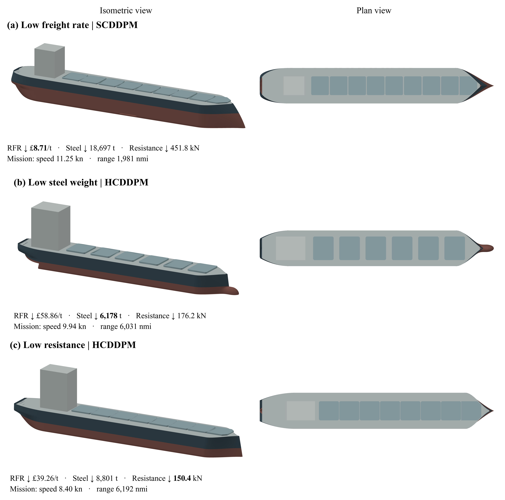

# GenISys

GenISys generates and evaluates preliminary bulkcarrier designs using DDPM,
HCDDPM, and SCDDPM. This repository provides one reusable model workflow,
the ship evaluator, dataset-construction tools, and CadQuery visualization.

`run_genisys.py` builds models, trains generators and guidance assets, and
samples designs with guidance off, constraint guidance, or constraint plus
required-freight-rate (RFR) guidance. The supporting implementations come from
Ada. Historical experiment suites and frozen source archives are excluded.

| Location | Purpose |
| --- | --- |
| `run_genisys.py` | Model workflow entry point |
| `models/` | Diffusion networks, architecture adapters, classifiers, critics, and sampling |
| `training_utils/` | Frozen coordinate schema, data preparation, training, checkpointing, and paper settings |
| `eval_utils/` | Generated-design evaluation, diversity, and distance metrics |
| `tools/` | Hull/design equations, ship simulator, engineering constraints, and parameter definitions |
| `cad_query_tools/` | CadQuery midship structure and full-system visualization |
| `parametric_repair_tools/` | Dataset repair and repair-evaluation pipeline |
| Root dataset scripts | Random generation, batch evaluation, compilation, and unified-table construction |
| `figures/` | Existing paper figures |

## Environment and data

For the existing macOS environment:

```bash
conda env create -f GenISys_Env.yml
conda activate GenISys_Env
```

For CUDA training, the existing Linux specifications are retained:

```bash
conda env create -n GenISys_Env -f GenISys_Cluster_Env.yml
conda env update -n GenISys_Env -f GenISys_CUDA_Env.yml
conda activate GenISys_Env
```

Run commands from the repository root. Model commands default to `cuda:0`;
`--device cpu` selects CPU explicitly. The environment files have been audited
against this workstation, with outstanding dependency conflicts documented in
[ENVIRONMENT_AUDIT.md](docs/ENVIRONMENT_AUDIT.md). Fresh environment creation
and the complete CUDA workflow have not been verified here.

Download the separately distributed dataset and restore this path:

```text
Ship_Systems_Designs_v1p1/Unified_Training_Dataset/
```

Alternatively, pass `--data-root /path/to/Unified_Training_Dataset` to every
model command. The release contains 100,000 random and 117,999 repaired designs,
217,999 total. The model workflow uses the released parent split and globally
feasible training rows. Population tables, generated designs, and checkpoint
binaries are excluded from GitHub.

## Build, train, and sample

First prepare the separate 50,000-hull guidance table with Ada's existing
builder. Skip this command if that table is already available under the
selected unified-data directory.

```bash
python run_genisys.py prepare-hull
```

Build each architecture and write its parameter count without training:

```bash
python run_genisys.py build --architecture all
```

Train all three generators, the shared constraint classifiers, and the RFR
critics using the saved paper recipe:

```bash
python run_genisys.py train --architecture all
```

Training retains Ada's checkpoint/resume behavior. For an individual component,
use `--component generator`, `--component classifiers`, or `--component rfr`.
Classifier training builds the shared architecture-specific collection. RFR
data preparation requires the trained DDPM checkpoint's full-state coordinate
transform, including when sampling only HCDDPM or SCDDPM. The default generator
seed is 2001; this workflow does not recreate the paper's experiment matrices
or five-fit statistical study.

Generate SCDDPM designs for a prescribed voyage range and evaluate them:

```bash
python run_genisys.py sample --architecture scddpm --guidance rfr \
  --range-nmi 5000 --count 100 --sampling-seed 820000 --evaluate
```

Use `--guidance constraint` for constraint guidance alone or `--guidance none`
to disable both guidance terms. Range remains locked in all three modes.
The fixed-range sampler includes the deterministic terminal update. Constraint
strength is 0.7; selected RFR strengths are 0.10 for DDPM/SCDDPM and 0.03 for
HCDDPM. `--rfr-strength` makes an explicit override. These presets retain the
original noise-blending and guidance behavior.

Each sampling folder contains `Controls_133.csv`, `Designs_189.csv`,
`Postprocess_Changes.csv`, and `Sampling_Report.json`. With `--evaluate`, the
existing evaluator writes per-attempt status, performance, constraints, and
failure records beneath `evaluation/`. A generated design has no feasibility
claim until evaluated. Existing sampling folders are preserved; use another
seed or output root for another request.

`--output-root` controls model and sample storage. `all` runs training followed
by sampling; `python run_genisys.py --help` lists the options.

## Dataset construction and CAD

[DATASET_CONSTRUCTION.md](docs/DATASET_CONSTRUCTION.md) lists the retained
generation, evaluation, repair, and compilation entry points. Their existing
algorithms are unchanged. The visualization implementation is CadQuery;
see [cad_query_tools/README.md](cad_query_tools/README.md).



These are existing paper examples from the free-range performance-guidance
study. They are illustrations, rather than outputs of the command above.

## Source integrity and validation

[SOURCE_PROVENANCE.md](docs/SOURCE_PROVENANCE.md) records the authoritative Ada
snapshot and the import/path relocations. Retained Ada function bodies were
compared with their sources using Python syntax trees. Local interface checks
exercise the new entry point; they do not validate Ada's trained models or
reproduce paper results. Engineering limitations remain documented in
[the evaluator limitations](docs/EVALUATOR_LIMITATIONS.md).
