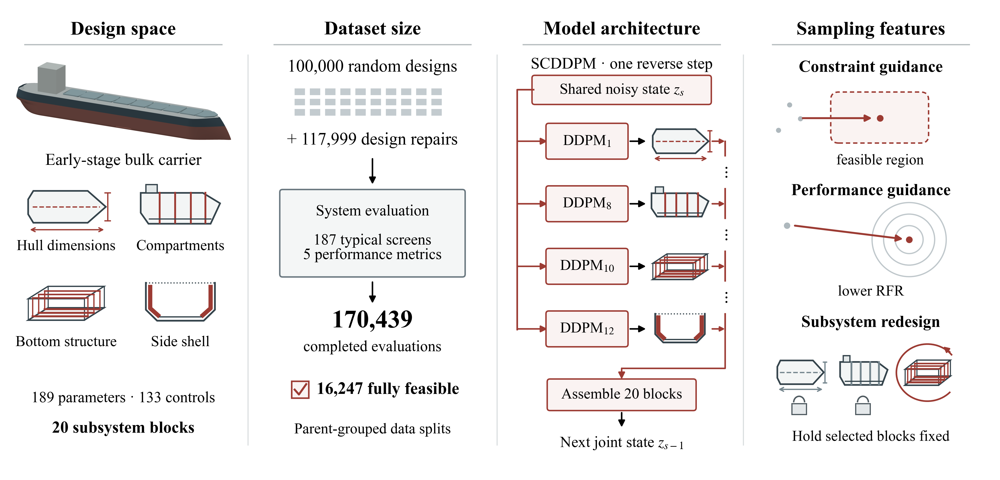
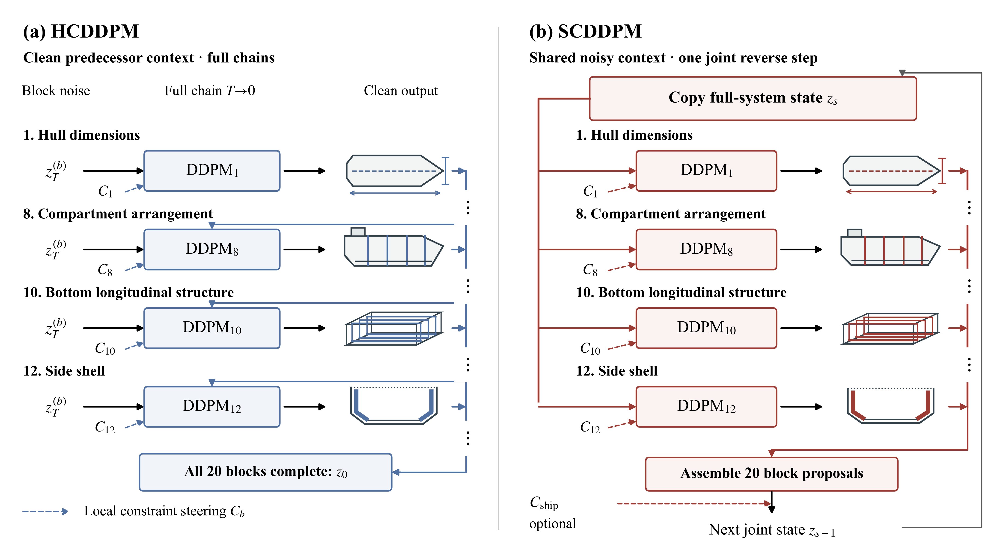

# Gen-I-Sys: Integrated Ship Systems Design Using Subsystem-Conditional Tabular Diffusion

**[Code on GitHub](https://github.com/noahbagz/GenISys) · [Dataset on Hugging Face](https://huggingface.co/datasets/DeCoDELab/GenISys)**

Ship design coordinates strongly coupled subsystems under engineering constraints
and competing performance objectives. **Gen-I-Sys** is a framework for learning
these relationships and generating integrated preliminary bulkcarrier designs.
It connects parametric geometry, structural CAD, ship-system simulation, and
guided diffusion in a common design representation.

*Project overview from the companion paper: 189 design parameters, 133 independent
controls, and 20 subsystem blocks linked by a shared engineering evaluator.*

The framework evaluates hull geometry, structure, capacities, loading equilibrium,
and hydrodynamic-method limits against 187 screening constraints. Five performance
objectives describe acquisition cost, annual cost, required freight rate (RFR),
steel weight, and resistance. RFR represents the modeled break-even freight charge
per tonne transported, including annualized capital costs.

## Models and guidance

The paper compares three ways to represent coupled design decisions with denoising
diffusion probabilistic models:

| Model | How design decisions are generated |
| --- | --- |
| **DDPM** | One monolithic denoiser predicts the complete control vector. |
| **HCDDPM** | Subsystem denoisers generate blocks sequentially, conditioned on completed predecessor blocks. |
| **SCDDPM** | Subsystem denoisers propose updates from the same noisy system state at each reverse step, allowing coupled decisions to remain jointly revisable. |

*HCDDPM completes each subsystem chain in order. SCDDPM assembles subsystem
proposals into a shared state before the next reverse step. Dashed paths denote
optional constraint guidance.*

Constraint classifiers steer generation toward feasibility, while learned
performance critics guide designs toward lower RFR. Locked coordinates preserve
requirements such as voyage range during sampling. The broader paper also examines
localized subsystem redesign with other design decisions held fixed.

## Main findings

None of 100,000 random designs satisfied all counted constraints. Equation-informed
repair produced 117,999 additional proposals, including 16,247 fully feasible
designs. Together, the random and repaired populations form a 217,999-design
training-data release with evaluation outcomes and repair lineage.

For generated designs required to travel **5,000 nautical miles**, five independent
trainings per architecture compared the yield of designs that were both fully
feasible and at or below a fixed, training-derived RFR threshold. Under the separately
selected feasibility and RFR guidance settings, qualifying yields were:

| DDPM | HCDDPM | SCDDPM |
| ---: | ---: | ---: |
| 51.10% | 47.54% | **55.70%** |

SCDDPM's qualifying yield was 9.0% higher than DDPM's and 17.2% higher than
HCDDPM's. HCDDPM led feasibility alone, while DDPM had the lowest mean RFR among
fully feasible designs. These results support integrated concept generation under
the studied requirements and settings.

## Using this repository

`run_genisys.py` provides the reusable build, train, and sample workflow for all
three architectures, with guidance off, constraint guidance, or constraint plus
RFR guidance. Supporting code includes dataset construction and repair, the ship
evaluator, diversity metrics, and CadQuery structure and system visualization.

See the [usage guide](docs/USAGE.md) for environment setup and commands, the
[dataset-construction guide](docs/DATASET_CONSTRUCTION.md), and the
[CadQuery guide](cad_query_tools/README.md). Download the data separately from
[Hugging Face](https://huggingface.co/datasets/DeCoDELab/GenISys).

This is preliminary-design research software. Feasibility refers to the implemented
engineering screens. Source provenance and the current execution-validation limits
are documented in [SOURCE_PROVENANCE.md](docs/SOURCE_PROVENANCE.md).

**Companion paper:** Noah J. Bagazinski and Faez Ahmed,
*Gen-I-Sys: Integrated Ship Systems Design Using Subsystem-Conditional Tabular Diffusion*.
